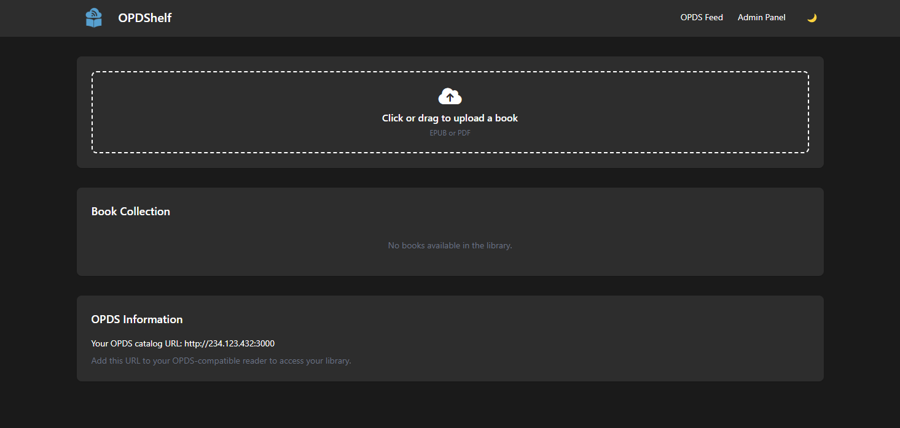

<p align="center">
  
</p>
<h1 align="center">OPDShelf</h1>
<p align="center"><em>Host your own OPDS library server in seconds</em></p>
<p align="center">
  <a href="#features">Features</a> •
  <a href="#installation">Install</a> •
  <a href="#configuration">Configuration</a> •
  <a href="#opds-catalog">OPDS catalog</a> •
  <a href="#faq">FAQ</a>
</p>

<p align="center">
  
</p>

---

## Features

🚀 **Simple & Fast**
- A single self-contained binary written in **Rust** (templates, styles and icons are embedded)
- No database required: your folder structure is the library
- Minimal memory use: books are never loaded whole into memory

📚 **Your library, organised**
- EPUB, PDF, FB2, MOBI, AZW, CBZ, CBR, DJVU, RTF, TXT and more
- Books in subfolders are found recursively (`Series/Volume 1.epub`)
- Title, authors, description, language and subjects read from EPUB, FB2, PDF and ComicInfo.xml
- Covers extracted from EPUB, FB2, PDF (first page), CBZ/ZIP, CBR, CB7 and CBT, served as small cached thumbnails in lists
- New, changed and deleted files show up instantly, no rescan or restart needed
- Only book formats are listed, so audiobooks or metadata files sharing the folder are ignored

📱 **OPDS 1.2 catalog**
- Works with any OPDS reader (KOReader, Moon+ Reader, Readest, Calibre, etc.)
- Browse by recently added, title, folder or author
- Search (OpenSearch) and pagination for large libraries
- Resumable downloads (HTTP range requests)

📖 **Read in the browser**
- EPUB reader with table of contents, font size, dark mode and position memory
- PDF, comic (CBZ, CBR, CB7, CBT, with right-to-left mode) and TXT readers
- Keyboard, touch swipe and mobile friendly

🖥️ **Web admin panel**
- Drag-and-drop uploads of several books at once, into any folder
- Rename, move and delete books
- Edit title, authors, description, subjects and more, and change the cover. Book files are never modified
- Fill in metadata and cover from an ISBN (Open Library, with Google Books as fallback)
- Search, folder filter and sorting
- Dark mode, works offline (no CDN)

🔒 **Secure by default**
- Optional username/password: Basic auth for readers, a login form for the panel
- Signed sessions, CSRF protection and paths confined to the books folder

---

## Installation

### Docker Compose (recommended)

```yaml
services:
  opdshelf:
    image: koalilla/opds-server:latest
    container_name: opdshelf
    ports:
      - "3000:3000"
    volumes:
      - ./books:/app/books
    environment:
      - ADMIN_USERNAME=admin
      - ADMIN_PASSWORD=change-me
    restart: unless-stopped
```

```bash
docker compose up -d
```

Open the admin panel at **http://localhost:3000/admin** and add **http://localhost:3000/** to your reader.

### From source

Requires [Rust](https://rustup.rs) and [Node.js](https://nodejs.org) (only to build the CSS and icons).

```bash
npm ci && npm run build        # Tailwind CSS + Font Awesome into static/
cargo build --release          # binary at target/release/opdshelf
BOOKS_DIR=~/Books ./target/release/opdshelf
```

In release builds the templates and `static/` are embedded into the binary, so it can be copied anywhere on its own.

---

## Configuration

All settings are environment variables.

| Variable | Default | Description |
|----------|---------|-------------|
| `PORT` | `3000` | Port to listen on |
| `HOST` | `0.0.0.0` | Address to bind to |
| `BOOKS_DIR` | `./books` | Library folder (scanned recursively) |
| `ADMIN_USERNAME` | none | Username. Authentication is enabled only when both username and password are set |
| `ADMIN_PASSWORD` | none | Password. Changing it logs out every session |
| `BASE_URL` | detected | Public URL used in feed links, e.g. `https://books.example.com`. Without it the URL is taken from the `Host` and `X-Forwarded-Proto`/`X-Forwarded-Host` headers |
| `ALLOWED_EXTENSIONS` | see below | Comma-separated list of extensions that are listed and accepted on upload |
| `EXCLUDE_EXTENSIONS` | none | Extensions removed from the allowed list, e.g. `zip,txt` |
| `PAGE_SIZE` | `50` | Books per page in OPDS feeds |
| `MAX_UPLOAD_MB` | `1024` | Maximum size of one upload request |
| `DATA_DIR` | `BOOKS_DIR/.opdshelf` | Where edited metadata, custom covers and the thumbnail cache are stored |
| `WATCH` | `true` | Watch the books folder for changes. Set to `false` on network shares that do not report changes; the library is then rescanned on each request |
| `SCAN_INTERVAL` | `600` | Seconds between full rescans while watching, as a safety net for missed events |
| `RUST_LOG` | `info` | Log level (`debug`, `info`, `warn`...) |

Default extensions: `epub kepub pdf fb2 fbz mobi azw azw3 azw4 cbz cbr cb7 cbt djvu rtf txt html htm doc docx odt zip` (plus `.fb2.zip`).

`REVERSE_PROXY=true` with `REVERSE_PROXY_HOST` from version 1 still works and is treated as `BASE_URL`.

Hidden files and folders (starting with `.`) are ignored.

PDF metadata and covers need `pdfinfo` and `pdftoppm` (poppler), and CBR/CB7/CBT support needs `bsdtar` (libarchive). Both are included in the Docker image; when running from source, install `poppler-utils` and `libarchive-tools` (or your distribution's equivalents). Without them those files are still listed and downloadable.

---

## OPDS catalog

| URL | Content |
|-----|---------|
| `/` | Catalog root: recently added, by title, folders, authors and search |
| `/opds/books?sort=name-asc` | Every book. `sort` is `date-desc` (default), `date-asc`, `name-asc` or `name-desc` |
| `/opds/folders/<path>` | Subfolders and books of a folder |
| `/opds/authors` | Authors, each linking to their books |
| `/opds/search?q=<terms>` | Search by title, author, path or subject |

Feeds are paginated with `?page=N`. The old `/?sort=...` URLs redirect to `/opds/books`.

When authentication is enabled, readers log in with HTTP Basic auth using the same username and password.

---

## Development

```bash
npm ci && npm run build   # or: npm run watch:css
cargo run                 # debug builds read views/ and static/ from disk
cargo test                # unit and HTTP integration tests
cargo fmt && cargo clippy --all-targets
```

---

## FAQ

<details>
<summary><strong>What is OPDS?</strong></summary>

OPDS (Open Publication Distribution System) is a standard for sharing digital books via web feeds, supported by most e-reader apps.
</details>

<details>
<summary><strong>How do I connect my e-reader?</strong></summary>

Add your server's URL (shown at the bottom of the admin panel) as an OPDS catalog in your reader app. If you set a username and password, enter them in the reader too.
</details>

<details>
<summary><strong>Books not showing up?</strong></summary>

Check that the files are inside `BOOKS_DIR` (any depth), that their extension is in the allowed list and that neither the file nor a parent folder starts with a dot.
</details>

<details>
<summary><strong>Does editing metadata change my files?</strong></summary>

No. Edits and custom covers are saved in `DATA_DIR` and applied on top of what is read from the file, in the panel and in the OPDS feed. "Restore file metadata" on the edit page discards them.
</details>

<details>
<summary><strong>I upgraded from 1.x and my reader shows folders instead of books</strong></summary>

The root URL is now a navigation catalog. Open "Recently added" or "All books by title", or point the reader to `/opds/books`.
</details>

---

## Contributing

Pull requests welcome! Open an issue first for feature discussions. CI runs `cargo fmt --check`, `cargo clippy` and `cargo test`.

## License

MIT
