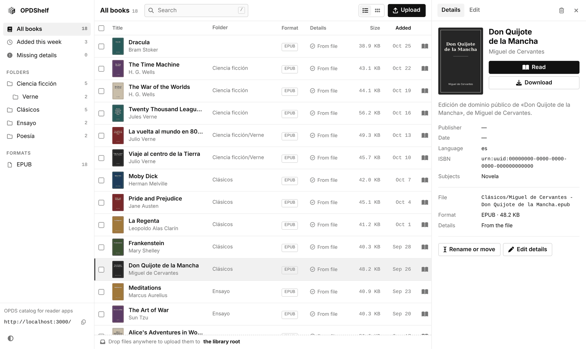
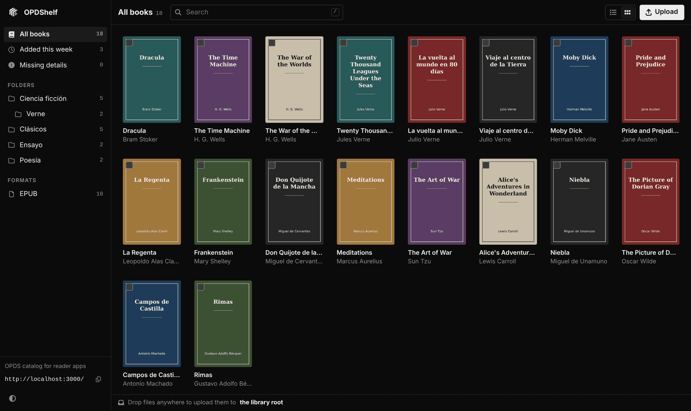
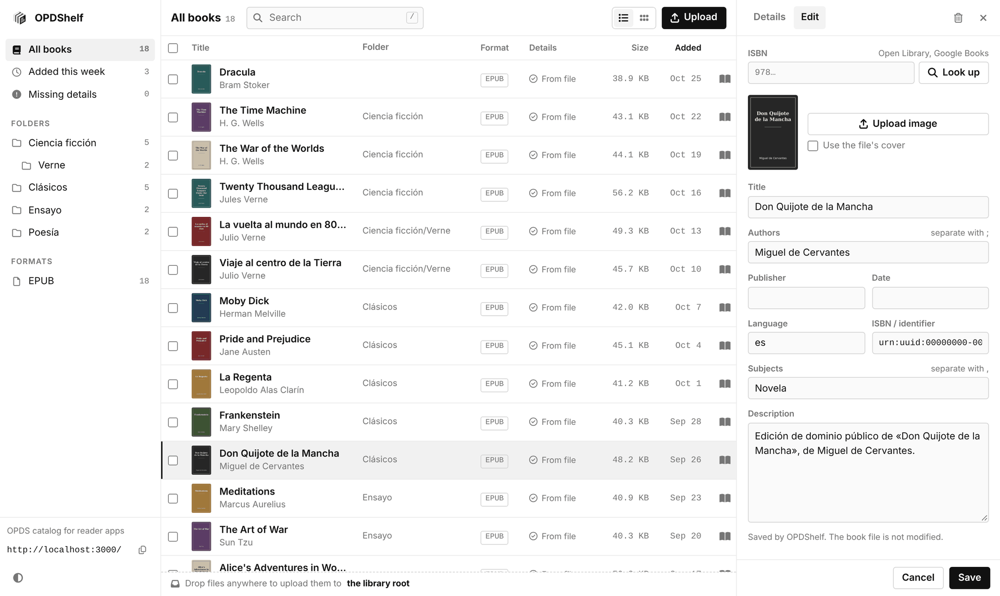
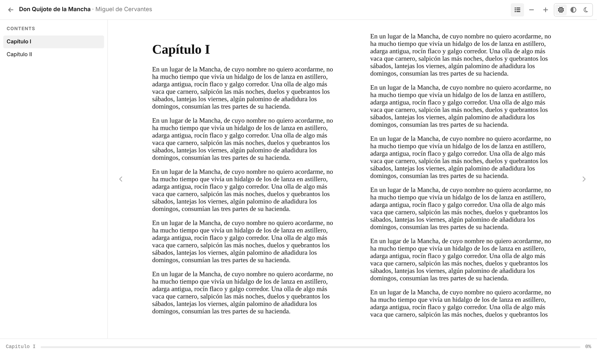

<p align="center">
  
</p>
<h1 align="center">OPDShelf</h1>
<p align="center"><em>Host your own OPDS library server in seconds</em></p>
<p align="center">
  <a href="#features">Features</a> •
  <a href="#real-time-sync">Real-time sync</a> •
  <a href="#installation">Install</a> •
  <a href="#configuration">Configuration</a> •
  <a href="#releases-and-channels">Releases</a>
</p>

<p align="center">
  
</p>

<table>
  <tr>
    <td width="33%"></td>
    <td width="33%"></td>
    <td width="33%"></td>
  </tr>
  <tr>
    <td align="center"><sub>Cover grid, dark mode</sub></td>
    <td align="center"><sub>Metadata editor with ISBN lookup</sub></td>
    <td align="center"><sub>EPUB reader</sub></td>
  </tr>
</table>

---

## Features

- **Single Rust binary, no database.** Your folder structure is the library; new, changed and deleted files show up instantly.
- **OPDS 1.2 catalog** for any reader (KOReader, Moon+ Reader, Readest, Calibre…): recent books, titles, folders, authors and series, with search and pagination ([URLs](docs/opds.md)).
- **Web panel** in English and Spanish: list or cover grid, drag-and-drop uploads, metadata and cover editing (with ISBN lookup), authors and series shelves, folders you create and fill with one click or by dragging books onto them, bulk move, delete and **mark as read / unread**, light and dark themes, works on phones.
- **Read in the browser**: EPUB (text settings, two-page spread), PDF, comics (CBZ, CBR, CB7, CBT) and TXT.
- **Devices page**: every device that syncs, whether it is connected right now, the books it is on and how far, and a live feed of reading activity.
- **Android app** and **KOReader plugin**, downloadable from the panel.
- EPUB, PDF, FB2, MOBI, AZW, CBZ, CBR, DJVU, RTF, TXT and more. Metadata and covers are read from the files, which are never modified.
- Optional username and password (Basic auth for readers, a login form for the panel).

## Real-time sync

Your reading position follows you between the browser, the Android app and KOReader **in real time**. Each reader keeps a live connection to the server, so a page turned on the phone shows up on the Kobo or Kindle within seconds, and the other way round, without KOReader's Progress sync (kosync).

- Reading offline is fine: the position is kept and sent once back online, with the time it was read, so newer reading done elsewhere always wins.
- When another device is further ahead, the reader goes there and says from where; when it is behind, or both read separately, it asks.
- **Set as last position**: select a sentence on any device and the others open the book exactly there.
- **Highlights and notes** sync too, in colour, between the browser, the app and KOReader. Each book has a Highlights tab in the panel, by chapter, with search, filters, a jump into the reader and export to Markdown or JSON.
- Books are matched by content, so a position follows a renamed or moved file. Finished books show 100 % everywhere.

Details, conflict handling and the API: [docs/sync.md](docs/sync.md).

### KOReader plugin

Download it from the panel (or the [`koreader-latest`](https://github.com/DanielPereod/opdshelf/releases/tag/koreader-latest) release), unzip `opdshelf.koplugin` into KOReader's `plugins` folder and restart. In **Tools → OPDShelf → Server** enter the address, username and password. Besides live sync it brings:

- **Library**: the server's catalog with covers, search and downloads (in the background, so e-ink screens such as Kindle keep refreshing).
- **Home screen**: works as KOReader's launcher, with the book to continue, the newest books on the server and the last ones read.

### Android app

Download it from the panel (or the [`android-latest`](https://github.com/DanielPereod/opdshelf/releases/tag/android-latest) release). Browse and download the catalog, read offline with a [Readium](https://readium.org) reader (themes, bookmarks, search, volume keys), filter your books by reading state, and sync as above. Building and signing: [docs/android.md](docs/android.md).

---

## Installation

The Docker image `koalilla/opds-server` runs on **linux/amd64** and **linux/arm64** (PC, NAS, Raspberry Pi).

```yaml
services:
  opdshelf:
    image: koalilla/opds-server:latest
    container_name: opdshelf
    ports:
      - "3000:3000"
    volumes:
      - ./books:/app/books
    environment:
      - ADMIN_USERNAME=admin
      - ADMIN_PASSWORD=change-me
    restart: unless-stopped
```

```bash
docker compose up -d
```

Open the panel at **http://localhost:3000/admin** and add **http://localhost:3000/** to your reader as an OPDS catalog.

The books folder must be writable (edits, covers and thumbnails are kept in `books/.opdshelf`). To mount it read-only, add `:ro` and point `DATA_DIR` to another volume. On network shares (SMB/NFS), add `WATCH=false`. On CasaOS, paste the Compose file above in **App Store → Custom Install**.

From source (needs [Rust](https://rustup.rs) and [Node.js](https://nodejs.org)):

```bash
npm ci && npm run build
cargo build --release
BOOKS_DIR=~/Books ./target/release/opdshelf
```

Coming from 1.x? See [docs/upgrading.md](docs/upgrading.md).

---

## Configuration

All settings are environment variables.

| Variable | Default | Description |
|----------|---------|-------------|
| `PORT` | `3000` | Port to listen on |
| `HOST` | `0.0.0.0` | Address to bind to |
| `BOOKS_DIR` | `./books` | Library folder (scanned recursively) |
| `ADMIN_USERNAME` | none | Username. Authentication is enabled only when both username and password are set |
| `ADMIN_PASSWORD` | none | Password. Changing it logs out every session |
| `BASE_URL` | detected | Public URL used in feed links, e.g. `https://books.example.com`. Without it the URL is taken from the `Host` and `X-Forwarded-Proto`/`X-Forwarded-Host` headers |
| `ALLOWED_EXTENSIONS` | see below | Comma-separated list of extensions that are listed and accepted on upload |
| `EXCLUDE_EXTENSIONS` | none | Extensions removed from the allowed list, e.g. `zip,txt` |
| `PAGE_SIZE` | `50` | Books per page in OPDS feeds |
| `MAX_UPLOAD_MB` | `1024` | Maximum size of one upload request |
| `APPS_URL` | `https://github.com/DanielPereod/opdshelf/releases/download` | Where the panel's Android app and KOReader plugin downloads come from |
| `APPS_CHANNEL` | `latest` (`beta` in the `:beta` image) | Which releases those downloads use: `latest` (from `main`) or `beta` |
| `DATA_DIR` | `BOOKS_DIR/.opdshelf` | Where edited metadata, custom covers and the thumbnail cache are stored |
| `TZ` | `UTC` | Time zone the reading statistics count days in, e.g. `Europe/Madrid` |
| `WATCH` | `true` | Watch the books folder for changes. Set to `false` on network shares that do not report changes; the library is then rescanned on each request |
| `SCAN_INTERVAL` | `600` | Seconds between full rescans while watching, as a safety net for missed events |
| `RUST_LOG` | `info` | Log level (`debug`, `info`, `warn`...) |

Default extensions: `epub kepub pdf fb2 fbz mobi azw azw3 azw4 cbz cbr cb7 cbt djvu rtf txt html htm doc docx odt zip` (plus `.fb2.zip`).

Hidden files and folders (starting with `.`) are ignored.

PDF metadata and covers need `pdfinfo` and `pdftoppm` (poppler), and CBR/CB7/CBT support needs `bsdtar` (libarchive). Both are included in the Docker image; when running from source, install `poppler-utils` and `libarchive-tools` (or your distribution's equivalents). Without them those files are still listed and downloadable.

---

## Releases and channels

| | Stable (`main`) | Beta (`beta`) |
|---|---|---|
| Docker image | `koalilla/opds-server:latest` | `koalilla/opds-server:beta` |
| Android app | [`android-latest`](https://github.com/DanielPereod/opdshelf/releases/tag/android-latest) | [`android-beta`](https://github.com/DanielPereod/opdshelf/releases/tag/android-beta) |
| KOReader plugin | [`koreader-latest`](https://github.com/DanielPereod/opdshelf/releases/tag/koreader-latest) | [`koreader-beta`](https://github.com/DanielPereod/opdshelf/releases/tag/koreader-beta) |

New features land in `beta` first. Every push publishes that channel's image and app releases, and the panel offers the apps of its own channel, so they update without updating the server.

---

## Development

```bash
npm ci && npm run build   # or: npm run watch:css
cargo run                 # debug builds read views/ and static/ from disk
cargo test
luajit koreader/test/plugin_test.lua koreader/opdshelf.koplugin   # also library_test, browser_test
cargo fmt && cargo clippy --all-targets
```

Pull requests welcome! Open an issue first for feature discussions.

## License

MIT
